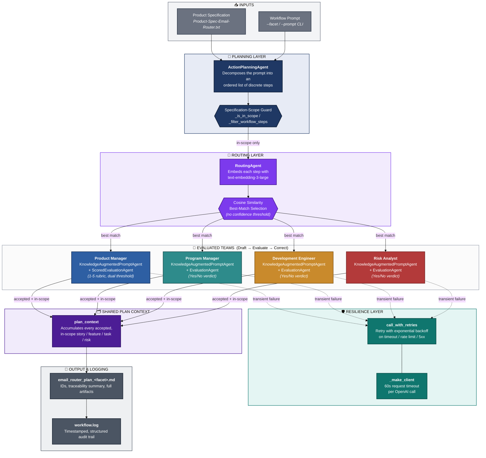

# AI-Powered Agentic Workflow for Project Management

> An orchestrated, multi-agent Python system that turns a single high-level prompt into a validated, structured project plan, user stories, product features, development tasks, and risk assessments, using a reusable library of seven LLM agent classes built on the OpenAI API.

**Pilot case study:** an AI-powered Email Router product, planned end-to-end by the workflow itself.

[](https://www.python.org/)
[](https://platform.openai.com/docs/api-reference/chat)
[](#license)
[](#testing--evidence)

> **submission:** this README analyzes the revised activity run set, `submission`, which superseded an earlier run set analyzed by a prior version of this README and its companion report. The underlying code changed between the two run sets (a shared context store and a specification-scope guard were added, see [Architecture](#architecture)), and the evidence-backed run set also captured a real, live ~16-minute API outage, see [Results at a Glance](#results-at-a-glance) and [Known Limitations](#known-limitations). Every number below is recomputed from the `submission` evidence directory` and `workflow.log` files.

---

## Table of Contents

1. [Overview](#overview)
2. [Key Features](#key-features)
3. [Architecture](#architecture)
4. [Datasets](#datasets)
5. [Agent Library](#agent-library)
6. [Project Structure](#project-structure)
7. [Getting Started](#getting-started)
8. [Usage](#usage)
9. [Enhancements](#enhancements)
10. [Testing & Evidence](#testing--evidence)
11. [Results at a Glance](#results-at-a-glance)
12. [Known Limitations](#known-limitations)
13. [Roadmap](#roadmap)
14. [Documentation](#documentation)
15. [References](#references)
16. [License](#license)

---

## Overview

Planning a software product, writing user stories, grouping them into features, breaking those into engineering tasks, and assessing risk, is normally a slow, manual, multi-role process. A single LLM prompt does not solve this reliably: it has no persona separation, no enforced output structure, no verification step, and, without deliberate engineering, no memory of what earlier steps already decided.

This project solves that with a **five-stage agentic workflow**: an `ActionPlanningAgent` decomposes a prompt into ordered steps, a specification-scope guard filters out anything the product specification puts out of scope, a `RoutingAgent` sends each remaining step to the right specialist team by embedding similarity, and four teams (Product Manager, Program Manager, Development Engineer, and Risk Analyst) each run a **draft-then-verify loop**, a `KnowledgeAugmentedPromptAgent` drafts the artifact and an `EvaluationAgent` (or a scored variant) checks it against an explicit structural rubric, sending corrections back until it passes. In `submission`, every team also reads and writes to a shared, in-memory `plan_context`, so later steps are no longer blind to what earlier steps already produced.

The system was built in two phases:

- **Phase 1** produced a reusable library of seven agent classes (`base_agents.py`), each independently tested against the live OpenAI API (`tests/*_test.py`).
- **Phase 2** composed four of those classes into `agentic_workflow.py`, a configurable, production-minded orchestration pipeline with a shared context store, a specification-scope guard, retry logic, structured logging, and five selectable planning facets.

Every claim in this README is backed by real, captured evidence (console transcripts and a structured run log), documented in full in **[`Agentic_Workflow_Project_Management_Report.docx`](./Agentic_Workflow_Project_Management_Report.docx)**, the companion evaluation report this README summarizes.

---

## Key Features

| Capability | Description |
|---|---|
|  **Reusable agent library** | Seven independent, single-responsibility agent classes usable in any workflow, not just this one. |
|  **Draft → Evaluate → Correct loop** | Every generated artifact is checked against an explicit rubric and revised automatically before acceptance. |
|  **Shared plan context** | Accepted stories, features, tasks and risks are filed into a shared `plan_context` so later steps, and the final plan builder, see what was already accepted rather than re-deriving it blind. |
|  **Specification-scope guard** | Planner steps and accepted artifacts are both checked against the product specification's stated scope and exclusions before they reach routing or publication. |
|  **Semantic routing** | Steps are routed to the right team using cosine similarity over OpenAI embeddings, no hard-coded keyword rules. |
|  **Scored evaluation** | The Product Manager team uses a 5-criterion, 1-to-5 rubric with a dual pass/fail threshold, not just a Yes/No verdict. |
|  **Configurable planning facets** | Generate a full plan, or just stories, features, tasks, or a risk assessment, from the command line. |
|  **Traceable output** | Published stories and tasks carry stable IDs (`US-xx`, `T-xxx`) and every task's story reference is checked against a real accepted story. |
|  **Resilient by design, live-tested** | Request timeouts, retry-with-backoff, and structured logging, and in `submission`'s evidence, a real ~16-minute API outage that these safeguards actually caught. |
|  **Auditable outputs** | Every run writes a Markdown deliverable plus a shared, timestamped `workflow.log`. |
|  **Evidence-tested** | 159 of 162 logged workflow steps succeeded (98.1%) across 10 real runs against the live OpenAI API; the 3 failures and 1 aborted run all trace to one external outage. |

---

## Architecture

The workflow is a pipeline with a feedback loop embedded in its middle stage. Two inputs (the product specification and the workflow prompt) feed an `ActionPlanningAgent`, which decomposes the prompt into ordered steps. A specification-scope guard removes any step that falls outside the product specification's stated scope. A `RoutingAgent` sends each remaining step to one of four specialist teams by embedding similarity. Each team runs its own draft-evaluate-correct loop, accepted output is filed into a shared `plan_context`, and a resilience layer wraps every call so a transient failure is retried, or, if unrecoverable, logged and skipped (or, for a planning-stage failure, the run aborts cleanly) rather than silently corrupting the deliverable.



**How to read this diagram:** each node group has its own color so the pipeline stage is identifiable at a glance, grey for inputs, navy for planning (now including the scope guard), purple for routing and the new shared context store, then a distinct color per team (blue = Product Manager, teal = Program Manager, gold = Development Engineer, red = Risk Analyst), dark teal for the resilience layer, and slate for output and logging. Solid arrows show the primary data flow; dashed arrows show the retry path triggered on a transient failure.

### Design notes

- **Only the ActionPlanningAgent sees the raw prompt.** Everything downstream operates on the ordered, scope-filtered step list it produces.
- **Routing still has no confidence threshold.** The highest cosine similarity always wins. Measured against `submission`'s own evidence this remains the single biggest limitation, see [Known Limitations](#known-limitations), essentially unchanged from the prior evidence despite the other fixes below.
- **Teams are no longer isolated.** `submission` adds a shared `plan_context`: every accepted, in-scope artifact is filed into it, and the full-plan builder assembles the published deliverable from that shared context rather than from each step's isolated output. This resolves the context-isolation limitation identified in the prior version of this project.
- **A specification-scope guard is new.** Planner steps and accepted artifacts are both checked against the product specification's stated exclusions (no spam filtering, no folder organization, no CRM integration, no mobile app, no internal employee email, no backend email-server modification) before they reach routing or publication.
- **The Risk Analyst team was added as an enhancement**, demonstrating that a new planning facet can be added with one new team and one new route, no change to the orchestration loop itself.

---

## Datasets

This project uses no external or downloaded dataset; every agent is a call against a general-purpose OpenAI model. What plays the role of a dataset is a small set of hand-authored text sources:

| Dataset | Used by | Role |
|---|---|---|
| `Product-Spec-Email-Router.txt` (121 lines) | Product Manager & Risk Analyst knowledge agents, `ActionPlanningAgent`, the scope guard | The single grounding document for the pilot: objectives, scope, exclusions, features, functional/non-functional requirements |
| A false fact ("The capital of France is London, not Paris") | `knowledge_augmented_prompt_agent_test.py` | Proves the agent answers from supplied knowledge, not training data |
| A ~500-word inline narrative about a marine biologist, Clara, and her podcast "Crosscurrents" | `rag_knowledge_prompt_agent_test.py` | Exercises chunk → embed → retrieve over a document too specific for the model to know from training |
| Three short domain descriptions (Texas / Europe / math word problems) | `routing_agent_test.py` | Tests whether embedding similarity resolves genuine near-ties (e.g. "Rome, Texas" vs. "Rome, Italy") |
| A three-recipe knowledge base (fried / scrambled / boiled eggs) | `action_planning_agent_test.py` | Tests that the planner selects only the relevant recipe's steps, in order |
| The workflow's own generated output (`email_router_plan_*.md`) | The full-plan builder, this README, the companion report | Not a supplied input, a system output: this run produced 6 published user stories, 15 features and 15 tasks |
| `evidence directory` + `workflow.log` | This README and the companion report | The observational evidence corpus every quantitative claim here is computed from |

See Section 5 of the companion report for the full walkthrough of each dataset and how it was used.

---

## Agent Library

All seven classes live in `base_agents.py` (`tests/workflow_agents/base_agents.py`, mirrored into `phase_2/workflow_agents/`) and were each verified with a standalone test script against the live OpenAI API.

| # | Class | Responsibility | Verified with |
|---|---|---|---|
| 6.1 | `DirectPromptAgent` | Relays a prompt straight to the LLM, no persona, no knowledge. | `tests/direct_prompt_agent_test.py` |
| 6.2 | `AugmentedPromptAgent` | Answers in a fixed persona. | `tests/augmented_prompt_agent_test.py` |
| 6.3 | `KnowledgeAugmentedPromptAgent` | Answers using a persona **and only** supplied knowledge. | `tests/knowledge_augmented_prompt_agent_test.py` |
| 6.4 | `RAGKnowledgePromptAgent` *(provided)* | Retrieval-augmented generation: chunk, embed, retrieve, answer. | `tests/rag_knowledge_prompt_agent_test.py` |
| 6.5 | `EvaluationAgent` / `ScoredEvaluationAgent` | Judges a worker agent's output and drives a correction loop. | `tests/evaluation_agent_test.py` |
| 6.6 | `RoutingAgent` | Routes a prompt to the best-matching agent by embedding similarity. | `tests/routing_agent_test.py` |
| 6.7 | `ActionPlanningAgent` | Decomposes a prompt into an ordered list of steps. | `tests/action_planning_agent_test.py` |

> Full walkthroughs, real console evidence, and design commentary for each class are in Section 6 of the companion report.

---

## Project Structure

```
Project/
├── README.md                          ← you are here
├── reflection.md                      ← strengths, limitations, proposed improvement (rewritten for submission)
├── requirements.txt                   ← pandas==2.2.3, openai==1.78.1, python-dotenv==1.1.0
│
├── tests/                             ← reusable agent library + Phase 1 tests
│   ├── workflow_agents/
│   │   ├── __init__.py
│   │   └── base_agents.py             ← all 7 agent classes
│   ├── direct_prompt_agent_test.py
│   ├── augmented_prompt_agent_test.py
│   ├── knowledge_augmented_prompt_agent_test.py
│   ├── rag_knowledge_prompt_agent_test.py
│   ├── evaluation_agent_test.py
│   ├── routing_agent_test.py
│   └── action_planning_agent_test.py
│
├── phase_2/                           ← orchestrated workflow
│   ├── workflow_agents/                 (copy of the finished library)
│   ├── Product-Spec-Email-Router.txt    (pilot product specification)
│   ├── agentic_workflow.py              (the orchestration pipeline: plan_context, scope guard, facets, retries)
│   ├── enhancements.md                  (Enhancements 1-3, detailed)
│   ├── workflow.log                     (10 logged runs)
│   └── email_router_plan_{full,stories,features,risk}.md   (published, scope-validated plans)
│                                          note: no email_router_plan_tasks.md in this run, see Known Limitations
│
└── evidence/                           ← 12 captured console transcripts (7 Phase 1 + 5 Phase 2)
    ├── phase1_*.txt
    └── phase2_{agentic_workflow,facet_stories,facet_features,facet_tasks,facet_risk}.txt
└── doc/                           
    ├── Agentic_Workflow_Project_Management_Report.pdf <- technical report
```

---

## Getting Started

### Prerequisites

- Python 3.9+
- An OpenAI API key with access to `gpt-3.5-turbo` and `text-embedding-3-large`

### Installation

```bash
# 1. Clone or unzip the project, then enter it
cd submission

# 2. Create and activate a virtual environment
python3 -m venv venv
source venv/bin/activate          # Windows: venv\Scripts\activate

# 3. Install dependencies
pip install -r requirements.txt

# 4. Configure your API key
cp .env.example .env               # if provided; otherwise create .env
# then edit .env and set OPENAI_API_KEY=your_key_here
# (a classroom "voc-" key requires OPENAI_BASE_URL to point at the course proxy;
#  base_agents.py now raises an actionable error if this is misconfigured)
```

---

## Usage

### Run the Phase 1 agent library tests

```bash
cd tests
python direct_prompt_agent_test.py
python augmented_prompt_agent_test.py
python knowledge_augmented_prompt_agent_test.py
python rag_knowledge_prompt_agent_test.py
python evaluation_agent_test.py
python routing_agent_test.py
python action_planning_agent_test.py
```

### Run the Phase 2 workflow

```bash
cd phase_2

# Full plan: stories + features + tasks
python agentic_workflow.py

# A single planning facet
python agentic_workflow.py --facet stories
python agentic_workflow.py --facet features
python agentic_workflow.py --facet tasks
python agentic_workflow.py --facet risk

# A fully custom prompt
python agentic_workflow.py --prompt "Generate a risk assessment plan for the Email Router"
```

Each run writes `email_router_plan_<facet>.md` (IDs, traceability summary, full artifacts) and appends structured entries to `workflow.log`.

---

## Enhancements

Four enhancements were added beyond the baseline project requirements; in `submission` two of them were themselves revised.

| # | Enhancement | What it does |
|---|---|---|
| 1 | **Multiple planning facets** | `--facet` / `--prompt` CLI flags plus a **Risk Analyst** team let the same code generate a full plan, stories only, features only, tasks only, or a risk assessment. |
| 2 | **Scored evaluation** | `ScoredEvaluationAgent` grades the Product Manager's stories on 5 weighted criteria (1-5 each), accepting only when the average reaches 4.0 **and** no single criterion falls below 3. Evidenced in `submission` by a real 4.40→4.80 reject-then-accept cycle. |
| 3 | **Error handling & logging** | Per-request timeouts, retry-with-exponential-backoff on transient failures, and structured, timestamped logging. In `submission` this is evidenced by a real ~16-minute live API outage the system caught and logged correctly (see [Results at a Glance](#results-at-a-glance)). |
| 4 | **Reflection** | [`reflection.md`](./reflection.md) — rewritten for `submission` — now documents the shared-context fix as resolved and proposes a semantic consolidation & coverage-validation stage as the next improvement. |
| — | **Shared plan context** *(new architectural addition, not a numbered enhancement)* | `plan_context` accumulates accepted output across steps; the full-plan builder assigns stable `US-xx`/`T-xxx` IDs and resolves each task's story reference against real accepted stories. |
| — | **Specification-scope guard** *(new architectural addition)* | Filters planner steps and accepted artifacts against the product specification's stated exclusions before routing or publication. |

See [`phase_2/enhancements.md`](./phase_2/enhancements.md) for technical detail on enhancements 1-3.

---

## Testing & Evidence

This system was tested against the **live OpenAI API**, not mocks. Two independent evidence sources back every quantitative claim in this README and in the companion report:

- **`evidence directory`**, 12 raw console transcripts, all 7 Phase 1 tests and 5 Phase 2 runs (the full plan and all 4 facets).
- **`workflow.log`**, a structured, timestamped log of **10** total workflow executions: 5 earlier exploratory runs that predate the specification-scope guard, and 5 evidence-backed runs (reproduced verbatim in `evidence directory`) that this README and the companion report treat as authoritative for `submission`.

| Phase 1 script | Result |
|---|---|
| `direct_prompt_agent_test.py` | Correctly answered "Paris" from general training knowledge |
| `augmented_prompt_agent_test.py` | Correct answer delivered in the specified persona |
| `knowledge_augmented_prompt_agent_test.py` | Correctly obeyed deliberately false supplied knowledge ("London") |
| `rag_knowledge_prompt_agent_test.py` | Correct, on-topic retrieval-augmented answer |
| `evaluation_agent_test.py` | Draft rejected on format, corrected, accepted in 2 iterations |
| `routing_agent_test.py` | 3 / 3 prompts routed to the correct specialist agent |
| `action_planning_agent_test.py` | 8 / 8 correct steps extracted, in order |

Full evidence tables, figures, and a step-by-step routing accuracy analysis are in the companion report.

---

## Results at a Glance

| Metric | Value | Source |
|---|---|---|
| Total logged workflow runs | 10 (5 exploratory + 5 evidence-backed) | `workflow.log` |
| Steps attempted / succeeded, all 10 runs | 162 / 159 (98.1%) | `workflow.log` |
| Steps attempted / succeeded, evidence-backed run set only | 113 / 110 (97.3%) | `evidence directory` |
| Step failures | 3, all in the features facet | `phase2_facet_features.txt` |
| Fully aborted runs | 1 (tasks facet — action-planning call itself failed) | `phase2_facet_tasks.txt` |
| Live API outage duration | ~16 minutes (HTTP 404 from the classroom proxy) | `workflow.log` timestamps |
| Avg. evaluator iterations (Product Manager, scored) | 1.71 (n=7) | evidence-backed run set |
| Avg. evaluator iterations (Program Manager / Dev Engineer / Risk Analyst) | 1.09 / 1.04 / 1.02 | evidence-backed run set |
| Full-plan run time (52 steps) | 412.0s | `phase2_agentic_workflow.txt` |
| Routing accuracy on individually classifiable steps | **~43%** (20 / 47) | full-plan evidence run |

The **~43% routing accuracy** figure is, again, the most important finding in this project, and it is essentially unchanged from the ~41% measured in the prior run set: the `RoutingAgent` still has no confidence threshold, so individually worded story/feature/task steps are frequently sent to an adjacent team rather than the one a human reviewer would choose, and the shared-context and scope-guard fixes below did not touch this. This is a measured result, not a hypothetical concern; see [Known Limitations](#known-limitations) and the full report's Results section (Section 10) for the complete step-by-step breakdown.

The live outage is, by contrast, good news for the error-handling enhancement: unlike the prior evidence, where 0 of 94 steps ever failed, `submission`'s evidence-backed run set shows the retry-and-skip path and the clean-abort path both firing correctly against a genuine, unplanned failure, and the very next run (risk, 33/33) confirms the system recovered without any code change.

---

## Known Limitations

- **Routing precision (unresolved, ~43%).** Cosine-similarity routing with no confidence threshold misrouted a majority of individually worded steps in real evidence, essentially unchanged from the prior evidence despite the fixes below. A minimum-similarity gate or a small classifier would likely help.
- **Context isolation between steps — RESOLVED in `submission`.** A shared `plan_context` now accumulates every accepted artifact, and the full-plan builder reads from it rather than from isolated per-step text; every task's story reference is checked against a real accepted story. What remains is narrower: one story in this run's own output (`US-04`) has no directly published implementing task, and the published feature list contains a couple of near-duplicate entries. This is exactly what `reflection.md`'s new proposed improvement (semantic consolidation & coverage validation) targets.
- **Evaluators are themselves LLMs.** They reliably catch structural/format violations (evidenced again in `submission` by a real 4.40→4.80 reject-then-accept cycle) but are not a factual correctness check.
- **Error-handling recovery path — now evidenced by a real live failure, but one single point of failure remains.** `submission`'s evidence-backed run set captured a genuine ~16-minute outage; the retry/skip path (3 failed steps, 16 succeeded) and the clean-abort path (0 steps, tasks facet) both fired correctly. What the same evidence shows is that a failure in the `ActionPlanningAgent`'s own opening call still aborts the entire run with zero steps attempted, since there is no partial plan to fall back to at that point.
- **Non-deterministic step counts, now measured at a larger magnitude.** The same full-plan prompt produced 24 steps in one run and 52 in another; the same tasks prompt produced 11 steps in one run and could not be evaluated at all in another (an infrastructure failure, not a decomposition difference, in that case). This is a larger swing than previously measured and worth investigating before relying on run-to-run comparable step counts.

---

## Roadmap

The single highest-value next step, identified in the rewritten `reflection.md` and independently supported by the routing and completeness findings above, is:

> **Add a semantic consolidation and coverage-validation stage** that operates only on accepted, live agent output: deduplicate near-identical accepted stories, features and tasks by semantic similarity, verify every published task's story link and every story's task coverage, and route a targeted correction request back to the relevant team when a gap is found, rather than inventing content deterministically. This should be paired with a minimum routing-confidence threshold, still not implemented, so a low-confidence match can be flagged for review instead of silently accepted.

(Note: the prior roadmap item, passing accepted output forward as shared context, is now done — see the shared `plan_context` described in [Architecture](#architecture) and [Known Limitations](#known-limitations).)

---

## Documentation

| Document | Purpose |
|---|---|
| [`reflection.md`](./reflection.md) | Strengths, limitations, and proposed improvement (rewritten for `submission`) |
| [`phase_2/enhancements.md`](./phase_2/enhancements.md) | Technical detail on enhancements 1-3 |
| [`Agentic_Workflow_Project_Management Technical Report`](doc/Agentic_Workflow_Project_Management_Report.pdf) | Full evidence-based evaluation report for `submission` (architecture, datasets, agent-by-agent walkthrough, testing, results, value statement, limitations) |

---

## References

- Anthropic. (2024). *Building effective agents.* [anthropic.com/research/building-effective-agents](https://www.anthropic.com/research/building-effective-agents)
- Lewis, P. et al. (2020). *Retrieval-Augmented Generation for Knowledge-Intensive NLP Tasks.* [arXiv:2005.11401](https://arxiv.org/abs/2005.11401)
- OpenAI. *Chat Completions API reference.* [platform.openai.com/docs/api-reference/chat](https://platform.openai.com/docs/api-reference/chat)
- OpenAI. (2024). *New embedding models and API updates.* [openai.com/blog/new-embedding-models-and-api-updates](https://openai.com/blog/new-embedding-models-and-api-updates)
- Yao, S. et al. (2022). *ReAct: Synergizing Reasoning and Acting in Language Models.* [arXiv:2210.03629](https://arxiv.org/abs/2210.03629)
- Udacity. *Agentic Workflows* (course cd14525), source course for this project's starter repository and product specification. [udacity.com/course/agentic-workflows--cd14525](https://www.udacity.com/course/agentic-workflows--cd14525)

---

## License

This project was built as an educational project (Udacity) and is intended for learning and portfolio purposes.

---

<p align="center"><i>Built with a reusable agent library, a draft-evaluate-correct loop, a shared plan context, and an honest accounting of where it still falls short.</i></p>
